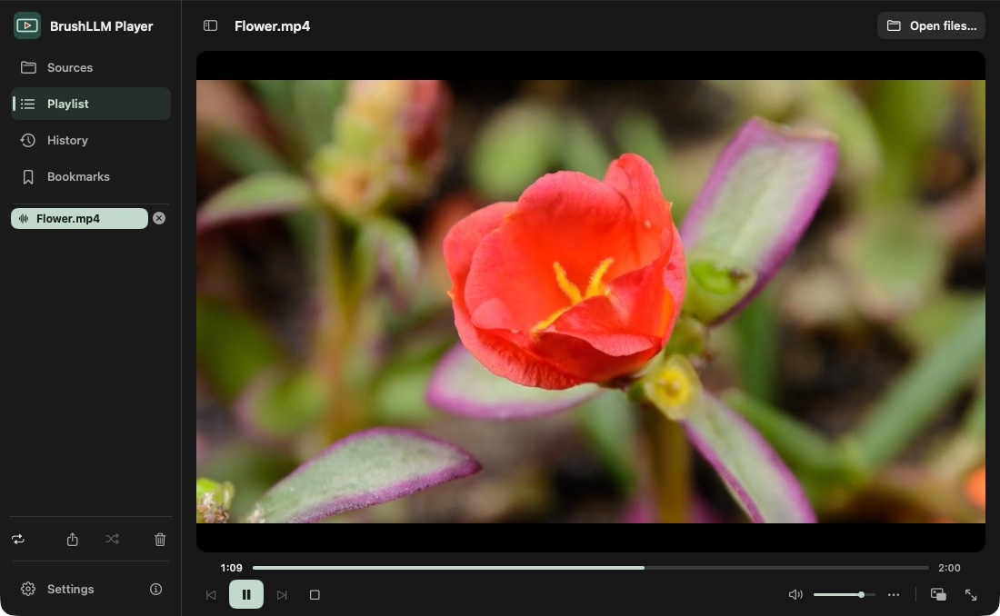

<p align="center">
  
</p>

<h1 align="center">BrushLLM Player</h1>

<p align="center">An mpv-powered desktop player for your files, media servers, and subtitles.</p>

<p align="center">
  <strong><a href="https://github.com/BrushLLM/brushllm-player/releases/latest">Download the latest release</a></strong> ·
  <a href="https://brushllm.com/player/">Player product page</a>
</p>

[Deutsch](docs/README.de.md) · [Español](docs/README.es.md) · [Français](docs/README.fr.md) · [Português (BR)](docs/README.pt-BR.md) · [日本語](docs/README.ja.md) · [한국어](docs/README.ko.md) · [简体中文](docs/README.zh-CN.md) · [繁體中文](docs/README.zh-TW.md)

## Download

| Device | Pick this installer |
| --- | --- |
| Mac with Apple Silicon and macOS 14 or later | `*-arm64.dmg` |
| Windows 10 or 11 on Intel or AMD | `*-x64.exe` |
| Windows on ARM64 | `*-arm64.exe` |

On Mac, open the disk image and drag **BrushLLM Player** into Applications. On Windows, run the installer for your processor. Both include mpv. The macOS app is ad hoc signed and the Windows installer is unsigned, so your system may ask you to review the download.



[Light appearance on macOS](.github/assets/player-macos-light.jpg)

## Watch your media

- **Local files and links.** Open or drop video and audio files such as MP4, MKV, WebM, FLAC, and MP3. Open direct HTTP(S) and HLS links from Sources.
- **Media servers.** Add WebDAV, SMB, FTP, Emby, or Jellyfin from Sources. Browse folders, open an item, or add a folder to the playlist.
- **Subtitles and tracks.** Select an embedded subtitle or audio track, or load a separate subtitle file such as SRT or ASS. mpv also finds matching local subtitles next to your video.
- **Playback and library.** Seek with the timeline, open chapters, and use fullscreen. The sidebar keeps your playlist, resume history, and bookmarks together.

## Platform differences

The macOS app uses SwiftUI and libmpv. It also includes ISO disc image playback, subtitle search and styling, stream recording, and macOS Now Playing integration.

The Windows app uses Tauri and a bundled mpv process. Video normally uses a native surface inside the main window. mpv can open its own video window if the desktop cannot provide that surface. Windows supports embedded and external subtitle tracks. The two apps share the layout and nine interface languages.

## Build and test

**macOS.** Select an installed Xcode toolchain. Swift Package Manager downloads MPVKit. Build the app and disk image locally.

```sh
bash scripts/package-macos.sh release --dmg
swift test
```

**Windows.** Install Node.js 24 LTS and the [Tauri desktop prerequisites](https://v2.tauri.app/start/prerequisites/). Extract `mpv.exe` and any companion DLLs for your processor into `tauri/src-tauri/bin/`. Use the [mpv release archives](https://github.com/mpv-player/mpv/releases/tag/v0.41.0).

```sh
cd tauri
npm ci
npm run build
npm test
npm run tauri -- build --bundles nsis -- --locked
```

For web layout changes, `npm run dev` opens a browser preview. Run `npm run icons` before running Cargo directly. To run Rust tests without bundled mpv resources, set `TAURI_CONFIG` to `{"bundle":{"resources":[]}}` and run `cargo test --locked` in `src-tauri`. The real-mpv integration test uses the binary specified by `BRUSHPLAYER_TEST_MPV`.

[GPL-3.0 license](LICENSE)
