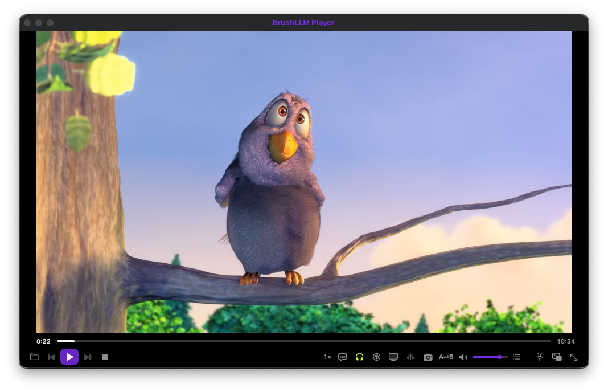

<p align="center">
  
</p>

<h1 align="center">BrushLLM Player</h1>

<p align="center">
  <a href="https://github.com/BrushLLM/brushllm-player/releases"></a>
  <a href="LICENSE"></a>
  
  
</p>

<p align="center">
  <strong><a href="https://www.brushllm.com">🌐 brushllm.com</a></strong> · <a href="https://github.com/BrushLLM/brushllm-player/releases">Releases</a>
</p>

<p align="center">An open-source cross-platform media player built on mpv — plays virtually every format, streams from WebDAV / SMB / FTP / Emby / Jellyfin, and ships a 9-language UI.</p>

<p align="center">
  
</p>

[English](README.md) | [Deutsch](docs/README.de.md) | [Español](docs/README.es.md) | [Français](docs/README.fr.md) | [Português (BR)](docs/README.pt-BR.md) | [日本語](docs/README.ja.md) | [简体中文](docs/README.zh-CN.md) | [繁體中文](docs/README.zh-TW.md) | [한국어](docs/README.ko.md)

---

## ✨ Features

- **Playback** — every mpv-supported format (MKV, MP4, AVI, MOV, WebM, FLAC, MP3, …) · hardware decoding (VideoToolbox, live toggle) · HDR output (PQ + EDR) · ISO disc images (Blu-ray largest-title, DVD seamless multi-VOB via EDL) · A-B loop · playback speed · frame stepping · chapters
- **Media servers** — browse and play directly from **WebDAV, SMB, FTP, Emby and Jellyfin**; sortable browser (name / modified / size) and folder-to-playlist
- **Network streams** — HTTP(S) direct links and m3u8/HLS, with adjustable read-ahead buffer and User-Agent
- **Subtitles** — auto-load matching sidecar files, external loading, live styling (font, size, color, position)
- **Library & tools** — playlist with drag-reorder · history with resume · bookmarks · screenshots · stream recording · equalizer · mini floating window
- **Also** — 9-language UI with instant switching · manual check-for-updates · zero telemetry

## 📥 Download

Grab the latest installer from [Releases](https://github.com/BrushLLM/brushllm-player/releases):

| Platform | File |
| --- | --- |
| macOS — Apple Silicon (M-series) | `.dmg` (arm64) |
| Windows 10/11 — x64 (Intel/AMD) | `.exe` (x64) |
| Windows 10/11 — ARM64 (Snapdragon) | `.exe` (arm64) |

> **Apps are unsigned.** macOS: right-click the app → **Open** on first launch (Gatekeeper). Windows: choose **Run anyway** when SmartScreen appears — the installer opens with a 9-language selector and bundles mpv, so no extra downloads are needed.

## 🌐 UI Languages

English · Deutsch · Español · Français · Português (Brasil) · 日本語 · 简体中文 · 繁體中文 · 한국어

Switch instantly in Settings — no restart.

<details>
<summary><strong>🛠 Develop</strong></summary>

```bash
# macOS (Swift)
./scripts/build-app.sh debug     # build + assemble .app
./scripts/build-app.sh release   # optimized build
open "build/BrushLLM Player.app"

# Windows (Tauri) — run on Windows
cd tauri && npm install
npx tauri build                  # NSIS installer (mpv goes in src-tauri/bin/)
```

macOS requires Xcode 15+ (Swift 5.9); Swift Package Manager resolves MPVKit automatically. Windows requires Node 18+, Rust, and the [mpv binary](https://mpv.io/installation/) unpacked into `tauri/src-tauri/bin/`.

</details>

<details>
<summary><strong>🏗 Architecture</strong></summary>

- **macOS app** — Swift 5 + SwiftUI + AppKit, dark glass design system. Playback core: libmpv via [MPVKit](https://github.com/MPVKit/MPVKit) (GPL build), OpenGL render API. Media servers: URLSession (WebDAV PROPFIND, Emby/Jellyfin REST), Network.framework (FTP), mount_smbfs (SMB). Persistence: UserDefaults (settings), Keychain (server passwords/tokens), JSON (history/bookmarks).
- **Windows app** — Tauri 2 + React + Rust; spawns the bundled mpv binary and controls it over JSON IPC (Unix domain socket / Windows named pipe).
- **Localization** — 9 language tables compiled into the binary; runtime switching with no restart.
- **Update checks** — manual button in Settings; queries the GitHub releases API and opens the release page in the browser (no automatic downloads).

</details>

## ⚠️ Known limitations

- The Windows app is a newer cross-platform rewrite — it currently covers playback, controls and file opening; the remaining macOS features are being migrated.
- Apps are unsigned (code signing can be added to CI later).

## 📄 License

Licensed under GPL v3 (mpv / libmpv licensing) — see [LICENSE](LICENSE).
