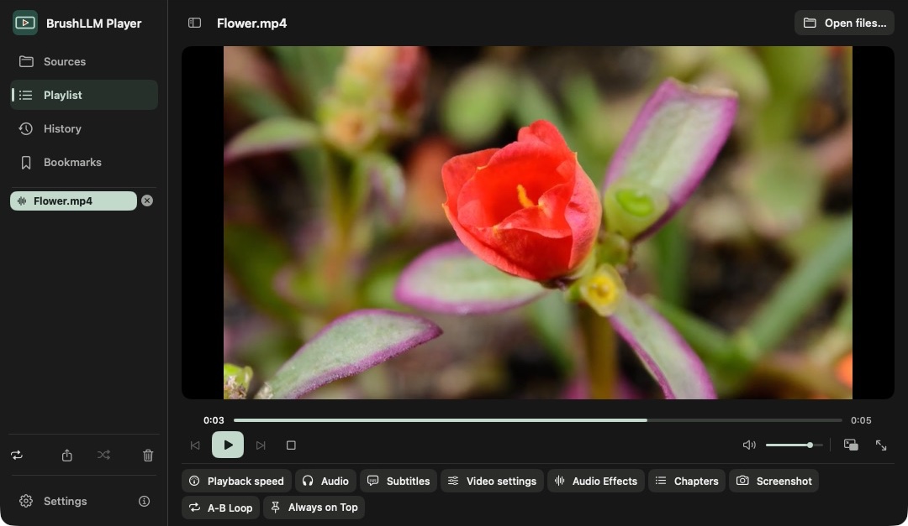

# BrushLLM Player

Ein Desktop-Player mit mpv für lokale Dateien, Medienserver und eigene Untertitel.

**[Aktuelle Version herunterladen](https://github.com/BrushLLM/brushllm-player/releases/latest)** · [Produktseite](https://brushllm.com/player/) · [English](../README.md)

## Download

| Gerät | Installationsdatei |
| --- | --- |
| Apple-Silicon-Mac mit macOS 14 oder neuer | `*-arm64.dmg` |
| Windows 10 oder 11 auf Intel oder AMD | `*-x64.exe` |
| Windows auf ARM64 | `*-arm64.exe` |

Öffne auf dem Mac das Image und ziehe **BrushLLM Player** in den Ordner „Programme“. Starte unter Windows die Installationsdatei für deinen Prozessor. Beide Versionen enthalten mpv. Die Mac-App ist ad hoc signiert, das Windows-Installationsprogramm ist unsigniert. Das System kann beim ersten Start eine Überprüfung anfordern.

[Helles Erscheinungsbild auf macOS](../.github/assets/player-macos-light.svg)

## Medien abspielen

- **Dateien und Links.** Öffne oder ziehe Video- und Audiodateien wie MP4, MKV, WebM, FLAC oder MP3 in den Player. Direkte HTTP(S)-Links und HLS-Streams öffnest du unter „Quellen“.
- **Medienserver.** Füge unter „Quellen“ WebDAV, SMB, FTP, Emby oder Jellyfin hinzu. Durchsuche Ordner, spiele einzelne Dateien ab oder füge einen Ordner zur Wiedergabeliste hinzu.
- **Untertitel und Spuren.** Wähle eingebettete Untertitel oder Audiospuren oder lade SRT- und ASS-Dateien. mpv erkennt passende Untertitel neben der lokalen Videodatei.
- **Steuerung und Mediathek.** Springe auf der Zeitleiste, wähle Kapitel oder wechsle in den Vollbildmodus. Die Seitenleiste enthält Wiedergabeliste, Verlauf mit Fortsetzen und Lesezeichen.

## Plattformunterschiede

Die macOS-App verwendet SwiftUI und libmpv. Sie unterstützt außerdem ISO-Disc-Images, Untertitelsuche und -gestaltung, Stream-Aufzeichnung und die macOS-Wiedergabesteuerung.

Die Windows-App verwendet Tauri und einen mitgelieferten mpv-Prozess. Das Video erscheint normalerweise im Hauptfenster. Wenn die native Videofläche nicht verfügbar ist, kann mpv ein separates Fenster öffnen. Windows unterstützt eingebettete und externe Untertitel. Beide Apps teilen sich das Layout und unterstützen neun Sprachen.

[Build- und Testanleitung](../README.md#build-and-test) · [GPL-3.0-Lizenz](../LICENSE)
