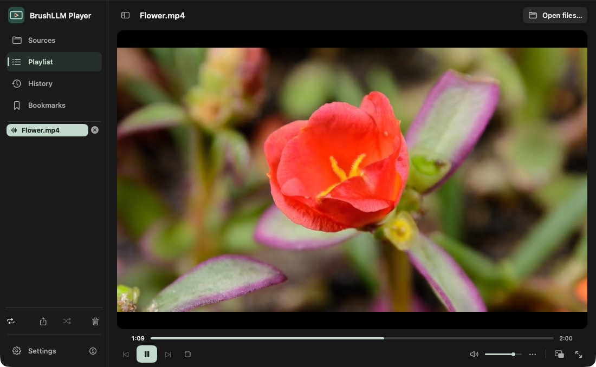

# BrushLLM Player

Un reproductor de escritorio basado en mpv para archivos locales, servidores multimedia y subtítulos propios.

**[Descargar la última versión](https://github.com/BrushLLM/brushllm-player/releases/latest)** · [Página del producto](https://brushllm.com/player/) · [English](../README.md)

## Descarga

| Equipo | Instalador |
| --- | --- |
| Mac con Apple Silicon y macOS 14 o posterior | `*-arm64.dmg` |
| Windows 10 u 11 con Intel o AMD | `*-x64.exe` |
| Windows en ARM64 | `*-arm64.exe` |

En Mac, abre la imagen de disco y arrastra **BrushLLM Player** a Aplicaciones. En Windows, ejecuta el instalador de tu procesador. Ambas versiones incluyen mpv. La aplicación de macOS lleva una firma ad hoc y el instalador de Windows no está firmado. El sistema puede pedirte que revises la descarga.

[Apariencia clara en macOS](../.github/assets/player-macos-light.jpg)

## Reproduce tus archivos

- **Archivos y enlaces.** Abre o arrastra archivos de audio y vídeo como MP4, MKV, WebM, FLAC y MP3. Abre enlaces HTTP(S) directos y emisiones HLS desde Fuentes.
- **Servidores multimedia.** Añade WebDAV, SMB, FTP, Emby o Jellyfin desde Fuentes. Explora carpetas, reproduce un archivo o añade una carpeta a la lista de reproducción.
- **Subtítulos y pistas.** Selecciona pistas de audio o subtítulos integrados, o carga un archivo SRT o ASS. mpv encuentra subtítulos locales que coincidan con el vídeo.
- **Reproducción y biblioteca.** Usa la barra de progreso, navega por capítulos o entra en pantalla completa. La barra lateral reúne la lista, el historial con reanudación y los marcadores.

## Diferencias entre plataformas

La aplicación de macOS usa SwiftUI y libmpv. También admite imágenes de disco ISO, búsqueda y estilos de subtítulos, grabación de emisiones e integración con los controles de reproducción de macOS.

La aplicación de Windows usa Tauri y un proceso mpv incluido. El vídeo suele aparecer en la superficie nativa de la ventana principal. Si esa superficie no está disponible, mpv puede abrir su propia ventana. Windows permite usar subtítulos integrados y externos. Ambas aplicaciones comparten el diseño y admiten nueve idiomas.

[Compilación y pruebas](../README.md#build-and-test) · [Licencia GPL-3.0](../LICENSE)
