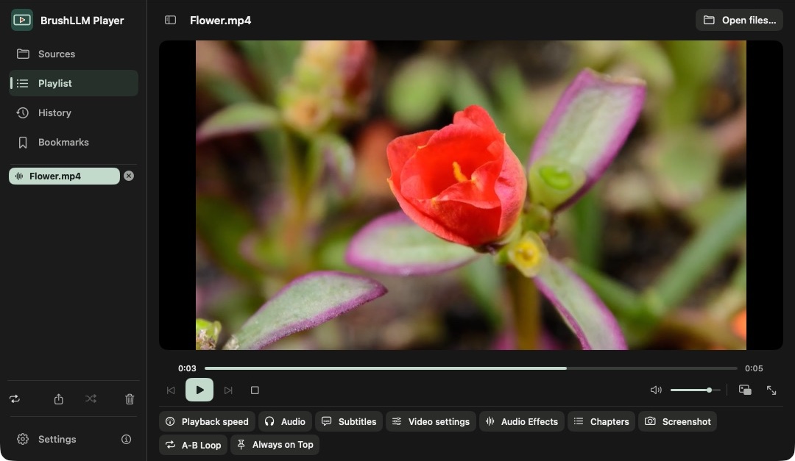

# BrushLLM Player

Un lecteur de bureau basé sur mpv pour vos fichiers, vos serveurs multimédias et vos sous-titres.

**[Télécharger la dernière version](https://github.com/BrushLLM/brushllm-player/releases/latest)** · [Page du produit](https://brushllm.com/player/) · [English](../README.md)

## Téléchargement

| Appareil | Installateur |
| --- | --- |
| Mac avec puce Apple et macOS 14 ou ultérieur | `*-arm64.dmg` |
| Windows 10 ou 11 sur Intel ou AMD | `*-x64.exe` |
| Windows sur ARM64 | `*-arm64.exe` |

Sur Mac, ouvrez l’image disque et glissez **BrushLLM Player** dans Applications. Sur Windows, utilisez l’installateur correspondant à votre processeur. Les deux versions incluent mpv. L’application macOS porte une signature ad hoc et l’installateur Windows n’est pas signé. Le système peut demander de vérifier le téléchargement.

[Apparence claire sur macOS](../.github/assets/player-macos-light.svg)

## Lire vos médias

- **Fichiers et liens.** Ouvrez ou déposez des fichiers audio et vidéo comme MP4, MKV, WebM, FLAC ou MP3. Ouvrez les liens HTTP(S) directs et les flux HLS depuis Sources.
- **Serveurs multimédias.** Ajoutez un serveur WebDAV, SMB, FTP, Emby ou Jellyfin depuis Sources. Parcourez les dossiers, ouvrez un fichier ou ajoutez un dossier à la liste de lecture.
- **Sous-titres et pistes.** Sélectionnez une piste audio ou des sous-titres intégrés ou chargez un fichier SRT ou ASS. mpv détecte les sous-titres locaux associés à la vidéo.
- **Lecture et bibliothèque.** Déplacez-vous sur la barre de progression, changez de chapitre ou passez en plein écran. Le volet latéral regroupe la liste de lecture, l’historique avec reprise et les favoris.

## Différences entre plateformes

L’application macOS utilise SwiftUI et libmpv. Elle prend aussi en charge la lecture d’images disque ISO, la recherche et le style des sous-titres, l’enregistrement de flux et les commandes de lecture de macOS.

L’application Windows utilise Tauri et un processus mpv fourni. La vidéo s’affiche dans la fenêtre principale quand une surface vidéo native est disponible. Sinon, mpv peut ouvrir sa propre fenêtre. Windows gère les sous-titres intégrés et externes. Les deux applications partagent la même disposition et proposent neuf langues.

[Compilation et tests](../README.md#build-and-test) · [Licence GPL-3.0](../LICENSE)
