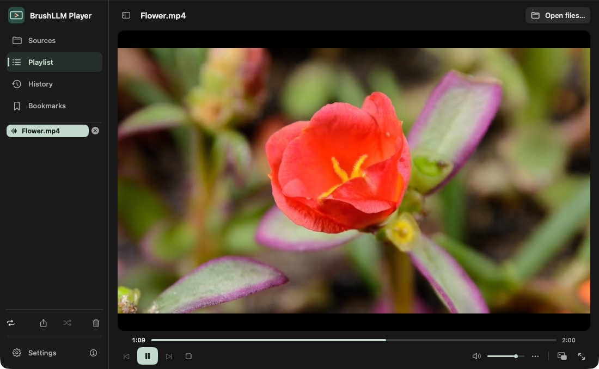

# BrushLLM Player

mpv を使ったデスクトップメディアプレーヤーです。ローカルファイル、メディアサーバー、外部字幕に対応します。

**[最新版をダウンロード](https://github.com/BrushLLM/brushllm-player/releases/latest)** · [製品ページ](https://brushllm.com/player/) · [English](../README.md)

## ダウンロード

| デバイス | インストーラー |
| --- | --- |
| Apple シリコン搭載 Mac、macOS 14 以降 | `*-arm64.dmg` |
| Intel または AMD 搭載 PC、Windows 10 または 11 | `*-x64.exe` |
| ARM64 版 Windows | `*-arm64.exe` |

Mac ではディスクイメージを開き、**BrushLLM Player** を「アプリケーション」に移動します。Windows では CPU に合ったインストーラーを実行します。どちらも mpv を同梱しています。macOS 版はアドホック署名、Windows インストーラーは未署名のため、システムから確認を求められる場合があります。

[macOS のライト表示](../.github/assets/player-macos-light.jpg)

## メディアを再生

- **ローカルファイルとリンク。** MP4、MKV、WebM、FLAC、MP3 などの動画・音声を開くか、ウィンドウにドラッグします。「ソース」から HTTP(S) の直接リンクや HLS ストリームを開けます。
- **メディアサーバー。** 「ソース」から WebDAV、SMB、FTP、Emby、Jellyfin を追加します。フォルダーを参照し、ファイルの再生やフォルダーごとのプレイリスト追加ができます。
- **字幕とトラック。** 内蔵の字幕や音声トラックを選んだり、SRT や ASS の字幕を読み込んだりできます。mpv はローカル動画に対応する字幕も自動で検索します。
- **再生操作とライブラリ。** タイムラインでシークし、チャプターや全画面表示を使えます。サイドバーではプレイリスト、続きから再生できる履歴、ブックマークを管理します。

## プラットフォームの違い

macOS 版は SwiftUI と libmpv を使用します。ISO ディスクイメージの再生、字幕検索と表示設定、ストリーム録画、macOS の再生中コントロールにも対応します。

Windows 版は Tauri と同梱の mpv プロセスを使用します。通常、動画はメインウィンドウのネイティブ表示領域に表示されます。この領域を利用できない場合は mpv が別ウィンドウを開くことがあります。内蔵字幕と外部字幕に対応します。レイアウトは共通で、両方のプラットフォームで 9 言語を利用できます。

[ビルドとテスト](../README.md#build-and-test) · [GPL-3.0 ライセンス](../LICENSE)
