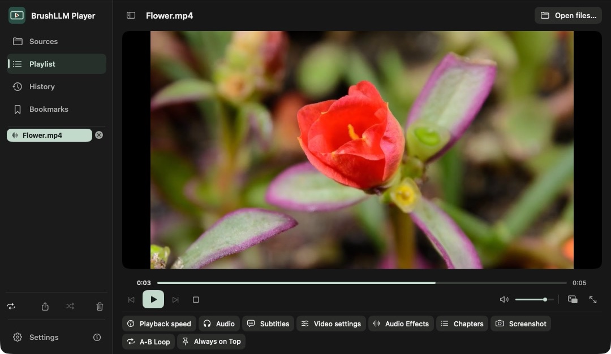

# BrushLLM Player

로컬 파일, 미디어 서버, 외부 자막을 지원하는 mpv 기반 데스크톱 플레이어입니다.

**[최신 버전 다운로드](https://github.com/BrushLLM/brushllm-player/releases/latest)** · [제품 페이지](https://brushllm.com/player/) · [English](../README.md)

## 다운로드

| 기기 | 설치 파일 |
| --- | --- |
| Apple Silicon Mac, macOS 14 이상 | `*-arm64.dmg` |
| Intel 또는 AMD PC, Windows 10 또는 11 | `*-x64.exe` |
| Windows ARM64 | `*-arm64.exe` |

Mac에서는 디스크 이미지를 열고 **BrushLLM Player**를 응용 프로그램 폴더로 드래그하세요. Windows에서는 프로세서에 맞는 설치 파일을 실행하세요. 두 버전 모두 mpv를 포함합니다. macOS 앱은 임시 서명되어 있으며 Windows 설치 파일은 서명되지 않았으므로 운영체제가 다운로드 확인을 요청할 수 있습니다.

[macOS 밝은 모드](../.github/assets/player-macos-light.svg)

## 미디어 재생

- **로컬 파일과 링크.** MP4, MKV, WebM, FLAC, MP3 등의 동영상과 오디오를 열거나 창에 끌어다 놓으세요. 소스에서 HTTP(S) 링크와 HLS 스트림을 열 수 있습니다.
- **미디어 서버.** 소스에서 WebDAV, SMB, FTP, Emby 또는 Jellyfin을 추가하세요. 폴더를 탐색하고 파일을 재생하거나 폴더의 항목을 재생 목록에 추가할 수 있습니다.
- **자막과 트랙.** 내장 자막이나 오디오 트랙을 선택하거나 SRT, ASS 자막 파일을 불러오세요. mpv는 로컬 영상 옆에서 이름이 일치하는 자막을 찾습니다.
- **재생 조작과 보관함.** 타임라인에서 이동하고 챕터와 전체 화면을 이용하세요. 사이드바에서 재생 목록, 이어보기 기록, 북마크를 관리할 수 있습니다.

## 플랫폼 차이

macOS 앱은 SwiftUI와 libmpv를 사용합니다. ISO 디스크 이미지 재생, 자막 검색과 스타일 설정, 스트림 녹화, macOS 재생 제어 연동도 지원합니다.

Windows 앱은 Tauri와 함께 제공되는 mpv 프로세스를 사용합니다. 영상은 보통 기본 창의 네이티브 영역에 표시됩니다. 이 영역을 사용할 수 없으면 mpv가 별도의 영상 창을 열 수 있습니다. Windows는 내장 자막과 외부 자막을 지원합니다. 두 앱의 레이아웃은 같으며 인터페이스는 9개 언어를 지원합니다.

[빌드와 테스트](../README.md#build-and-test) · [GPL-3.0 라이선스](../LICENSE)
