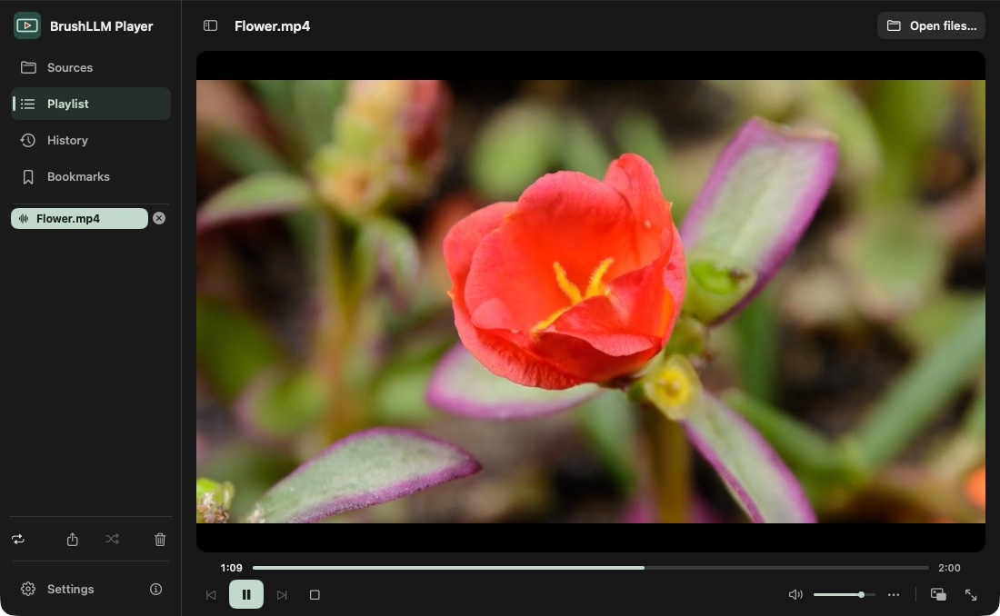

# BrushLLM Player

Um reprodutor de mídia para desktop com mpv, feito para seus arquivos, servidores de mídia e legendas.

**[Baixar a versão mais recente](https://github.com/BrushLLM/brushllm-player/releases/latest)** · [Página do produto](https://brushllm.com/player/) · [English](../README.md)

## Download

| Dispositivo | Instalador |
| --- | --- |
| Mac com chip Apple e macOS 14 ou posterior | `*-arm64.dmg` |
| Windows 10 ou 11 com Intel ou AMD | `*-x64.exe` |
| Windows em ARM64 | `*-arm64.exe` |

No Mac, abra a imagem de disco e arraste **BrushLLM Player** para Aplicativos. No Windows, execute o instalador do seu processador. As duas versões incluem o mpv. O aplicativo macOS tem assinatura ad hoc e o instalador Windows não está assinado. O sistema pode pedir que você verifique o download.

[Aparência clara no macOS](../.github/assets/player-macos-light.jpg)

## Reproduza suas mídias

- **Arquivos e links.** Abra ou arraste arquivos de vídeo e áudio como MP4, MKV, WebM, FLAC e MP3. Abra links HTTP(S) diretos e transmissões HLS em Fontes.
- **Servidores de mídia.** Adicione WebDAV, SMB, FTP, Emby ou Jellyfin em Fontes. Navegue nas pastas, reproduza um arquivo ou adicione a pasta à lista de reprodução.
- **Legendas e faixas.** Selecione legendas ou faixas de áudio incorporadas ou carregue um arquivo SRT ou ASS. O mpv identifica legendas locais correspondentes ao vídeo.
- **Reprodução e biblioteca.** Use a barra de progresso, navegue pelos capítulos e assista em tela cheia. A barra lateral reúne a lista de reprodução, o histórico com retomada e os marcadores.

## Diferenças entre plataformas

O aplicativo macOS usa SwiftUI e libmpv. Também oferece reprodução de imagens ISO, busca e ajustes de estilo de legendas, gravação de transmissões e integração com os controles de reprodução do macOS.

O aplicativo Windows usa Tauri e um processo mpv incluído. O vídeo normalmente aparece na área nativa da janela principal. Se essa área não estiver disponível, o mpv pode abrir uma janela própria. O Windows oferece legendas incorporadas e externas. Os dois aplicativos compartilham o layout e têm interface em nove idiomas.

[Compilação e testes](../README.md#build-and-test) · [Licença GPL-3.0](../LICENSE)
