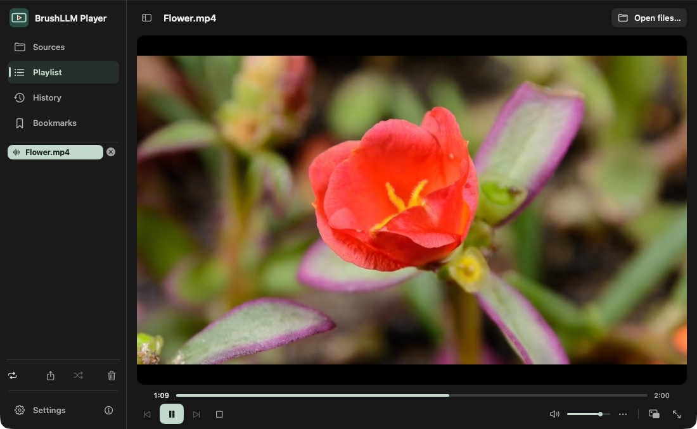

# BrushLLM Player

一款由 mpv 驱动的桌面播放器，支持本地文件、媒体服务器和独立字幕。

**[下载最新版本](https://github.com/BrushLLM/brushllm-player/releases/latest)** · [Player 产品页](https://brushllm.com/zh-CN/player/) · [English](../README.md)

## 下载

| 设备 | 安装包 |
| --- | --- |
| Apple 芯片 Mac，macOS 14 或更新版本 | `*-arm64.dmg` |
| Intel 或 AMD 电脑，Windows 10 或 11 | `*-x64.exe` |
| Windows ARM64 电脑 | `*-arm64.exe` |

在 Mac 上打开磁盘映像，将 **BrushLLM Player** 拖入「应用程序」。在 Windows 上运行与处理器匹配的安装包。两版都内置 mpv。macOS 应用采用临时签名，Windows 安装包未签名，系统可能会要求检查下载。

[macOS 浅色外观](../.github/assets/player-macos-light.jpg)

## 播放媒体

- **本地文件与链接。** 打开或拖入 MP4、MKV、WebM、FLAC、MP3 等音视频。从「媒体来源」打开 HTTP(S) 直链和 HLS 流。
- **媒体服务器。** 从「媒体来源」添加 WebDAV、SMB、FTP、Emby 或 Jellyfin。可浏览目录、播放单个文件或将整个文件夹加入播放列表。
- **字幕与音轨。** 选择内嵌字幕或音轨，也可载入 SRT、ASS 等外挂字幕。mpv 会在本地视频旁查找匹配的字幕。
- **播放与收藏。** 用进度条跳转，按章节定位或进入全屏。侧栏可切换播放列表、续播历史和书签。

## 平台差异

macOS 版使用 SwiftUI 和 libmpv，另外支持 ISO 光盘镜像、字幕搜索和样式调整、流录制及 macOS「正在播放」集成。

Windows 版使用 Tauri 和内置 mpv 进程。视频通常显示在主窗口的原生画面区域。桌面无法提供该区域时，mpv 可以另开视频窗口。Windows 支持内嵌和外挂字幕。两版共用布局并支持九种界面语言。

[构建与测试说明](../README.md#build-and-test) · [GPL-3.0 许可证](../LICENSE)
