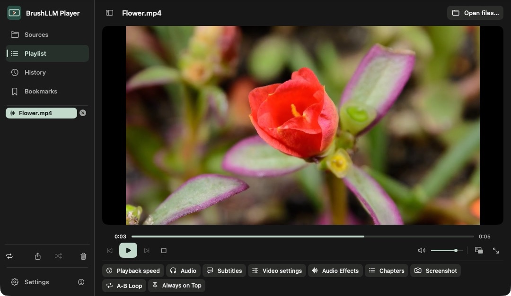

# BrushLLM Player

由 mpv 驅動的桌面播放器，可播放本機檔案、瀏覽媒體伺服器並載入外掛字幕。

**[下載最新版本](https://github.com/BrushLLM/brushllm-player/releases/latest)** · [Player 產品頁](https://brushllm.com/zh-CN/player/) · [English](../README.md)

## 下載

| 裝置 | 安裝檔 |
| --- | --- |
| Apple 晶片 Mac，macOS 14 或更新版本 | `*-arm64.dmg` |
| Intel 或 AMD 電腦，Windows 10 或 11 | `*-x64.exe` |
| Windows ARM64 電腦 | `*-arm64.exe` |

在 Mac 上打開磁碟映像檔，將 **BrushLLM Player** 拖進「應用程式」。在 Windows 上執行符合處理器的安裝檔。兩版均內附 mpv。macOS 應用程式採用臨時簽署，Windows 安裝檔未簽署，系統可能要求確認下載。

[macOS 淺色外觀](../.github/assets/player-macos-light.svg)

## 播放媒體

- **本機檔案與連結。** 開啟或拖入 MP4、MKV、WebM、FLAC、MP3 等影音檔案。也可從「媒體來源」開啟 HTTP(S) 直接連結和 HLS 串流。
- **媒體伺服器。** 從「媒體來源」加入 WebDAV、SMB、FTP、Emby 或 Jellyfin。可瀏覽資料夾、播放單一檔案或將整個資料夾加入播放清單。
- **字幕與音軌。** 選擇內嵌字幕或音軌，也可載入 SRT、ASS 等字幕檔。mpv 會在本機影片所在的資料夾尋找相符的字幕。
- **播放與收藏。** 使用進度列跳轉、切換章節或進入全螢幕。側邊欄集中管理播放清單、續播記錄和書籤。

## 平台差異

macOS 版使用 SwiftUI 與 libmpv，另支援 ISO 光碟映像檔播放、字幕搜尋與樣式調整、串流錄製，以及 macOS「播放中」整合。

Windows 版使用 Tauri 與內附的 mpv 程序。影片通常顯示在主視窗原生區域，桌面無法提供該區域時，mpv 可另開影片視窗。Windows 支援內嵌和外掛字幕。兩版共用版面並支援九種介面語言。

[建置與測試說明](../README.md#build-and-test) · [GPL-3.0 授權](../LICENSE)
